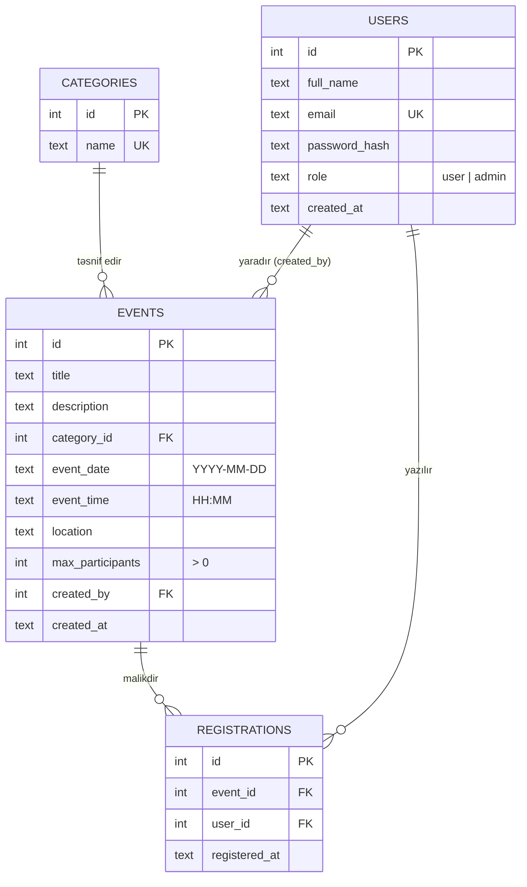

# Verilənlər bazasının strukturu

DBMS: **SQLite**. Sxem: [`app/schema.sql`](../app/schema.sql). Hər bağlantıda `PRAGMA foreign_keys = ON` aktivdir.

## ER diaqramı

## Cədvəllər

| Cədvəl | Təyinatı | Əsas məhdudiyyətlər |
|--------|----------|----------------------|
| `categories` | Tədbir kateqoriyaları | `name` UNIQUE |
| `users` | İstifadəçilər və adminlər | `email` UNIQUE, `role` CHECK (`user`/`admin`), parol yalnız hash kimi |
| `events` | Tədbirlər | `max_participants` CHECK > 0, `category_id` FK |
| `registrations` | İstifadəçi ↔ tədbir qeydiyyatı | **UNIQUE (event_id, user_id)** |

## Əlaqələr

- **categories 1 — N events:** hər tədbir bir kateqoriyaya aiddir. `ON DELETE RESTRICT` — istifadədə olan kateqoriya silinə bilməz.
- **users 1 — N events** (`created_by`): tədbiri yaradan admin. `ON DELETE SET NULL` — admin silinsə tədbir qalır.
- **events N — M users** `registrations` vasitəsilə (çox-çoxa əlaqə üçün ara cədvəl). Hər sətir konkret istifadəçini konkret tədbirlə əlaqələndirir.
  `ON DELETE CASCADE` — tədbir və ya istifadəçi silinəndə əlaqəli qeydiyyatlar da silinir (yetim sətirlər qalmır).

## Məlumat bütövlüyünün təmin edilməsi

1. **Təkrar qeydiyyat:** `UNIQUE (event_id, user_id)` məhdudiyyəti bazada qaydanı təmin edir. Tətbiq də əvvəlcədən yoxlayır, amma eyni anda iki sorğu gəlsə belə baza ikincisini rədd edir.
2. **Limit aşımı:** "say < limit" yoxlaması və əlavə etmə `BEGIN IMMEDIATE` tranzaksiyasında icra olunur. SQLite yazı kilidini dərhal götürdüyü üçün eyni anda iki nəfər sonuncu yerə yazıla bilmir.
3. **Düzgün dəyərlər:** `CHECK (max_participants > 0)`, `CHECK (role IN (...))`, `NOT NULL` sahələr.
4. **İstinad bütövlüyü:** xarici açarlar (`FOREIGN KEY`) və `PRAGMA foreign_keys = ON`.
5. **Təhlükəsiz sorğular:** bütün SQL `?` / adlandırılmış parametrlərlə yazılıb; istifadəçi məlumatı heç vaxt sətrə birləşdirilmir. `LIKE` axtarışında `%` və `_` simvolları escape olunur.
6. **İndekslər:** `events(event_date)`, `events(category_id)`, `registrations(event_id)`, `registrations(user_id)` — axtarış və say hesablamaları üçün.

Tarix və saat ISO formatında (`YYYY-MM-DD`, `HH:MM`) mətn kimi saxlanılır; bu format leksikoqrafik sıralama ilə xronoloji sıralamanı üst-üstə salır, ona görə tarixi müqayisə (`<`, `>=`) və `ORDER BY` düzgün işləyir.
